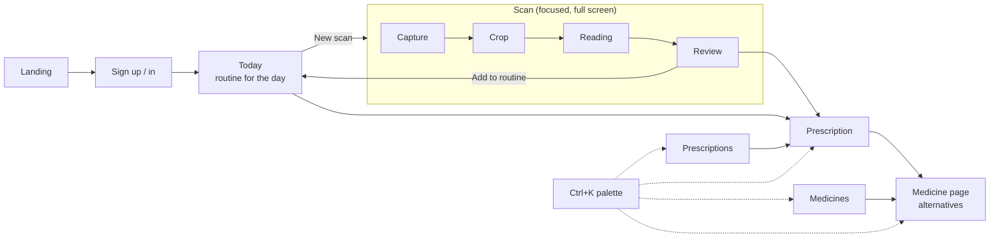
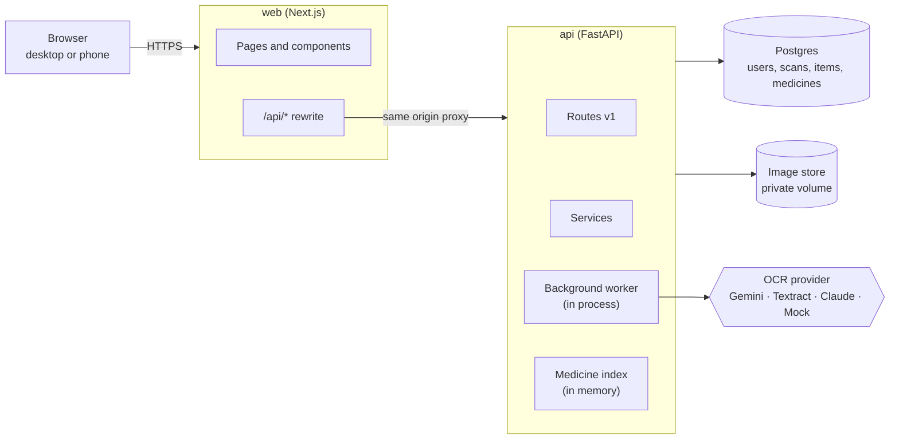
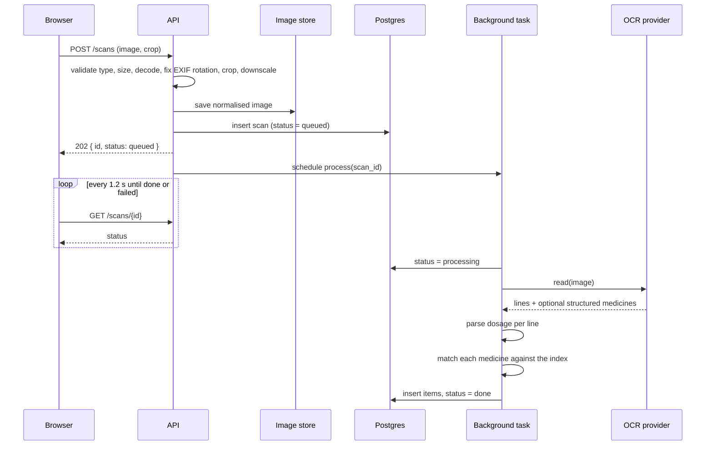
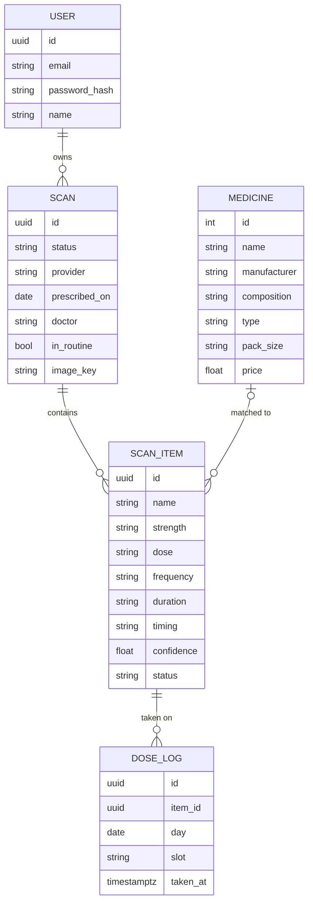

# RxVision: High Level Design

RxVision turns a photo of a handwritten prescription into a reviewed, structured
medication list: medicine, strength, dose, frequency, duration and timing, each
linked to a known product in a medicine catalogue. It then turns that list into
a daily routine, because reading a prescription is only the first step; taking
it correctly for the full course is the actual goal.

This document covers the system as a whole. The [LLD](LLD.md) covers modules,
schemas, algorithms and API contracts.

## 1. Why a redesign

The first version was a PyQt desktop app. It worked as a demo but had structural
limits that no amount of patching would fix:

| Problem in v1 | Consequence | v2 answer |
|---|---|---|
| Desktop only | Has to be installed; no phone camera | Web app, works on mobile |
| OCR ran on the UI thread or a single QThread | Window froze during OCR and lookups | Async API, background processing, polling |
| One OCR engine (Textract), 12.9% recall on handwriting | Most medicines missed | Pluggable OCR providers, vision LLM by default |
| Matcher scanned 254k names per line | Seconds per line | Trigram index (already built in v1, never wired in) |
| Output was a bare list of names | No dose, frequency or duration | Structured extraction per item |
| No way to correct results | A wrong match was final | Review and edit every item |
| Nothing persisted | Results lost on close | Accounts and scan history |
| Medicine details from a separate hand-deployed Lambda | Extra moving part, hard-coded URL | Catalogue lives in the same database |

## 2. Goals and non-goals

**Goals**

- Upload or photograph a prescription, optionally crop it, and get a structured
  list within a few seconds.
- Every extracted item shows where it came from (the raw OCR line) and how sure
  the system is (a match score).
- The user can fix, add or remove items, and the corrected list is what gets
  exported.
- Confirmed prescriptions become a daily routine: what to take this morning,
  afternoon, evening and night, which day of the course it is, and what is
  ending soon. Doses can be ticked off.
- Every medicine has a page: composition, the user's own history with it, and
  catalogue alternatives with the same composition (often much cheaper).
- Runs locally with one command and zero API keys (mock OCR), and gets real
  accuracy as soon as a provider key is added.

**Non-goals**

- Clinical decision support. RxVision reads prescriptions; it does not judge
  them, check interactions or dispense. The UI says so.
- Training a handwriting model. v1 already showed there is no labelled corpus to
  train on; managed OCR plus good post-processing is the better trade.
- Multi-tenant organisations, roles or sharing. One user, their own scans.

## 3. Requirements

**Functional**

| ID | Requirement |
|---|---|
| F1 | Register, sign in, sign out |
| F2 | Upload a JPEG, PNG or WebP image up to 10 MB, with an optional crop rectangle |
| F3 | Extract medicines with strength, dose, frequency, duration, timing |
| F4 | Match each medicine to the catalogue with a confidence score |
| F5 | Edit, add, delete and confirm items on a scan |
| F6 | Browse and search past scans; delete a scan |
| F7 | Export a scan as CSV or PDF |
| F8 | Search the catalogue (autocomplete) and view a medicine's details |
| F9 | Add a prescription to the routine with a start date; see the routine for any day |
| F10 | Mark a dose taken or not taken for a day and slot |
| F11 | List every medicine the user has been prescribed, with history |
| F12 | Show catalogue alternatives with an identical composition |
| F13 | Update profile and password, export all data, delete the account |

**Non-functional**

| Concern | Target |
|---|---|
| Latency | Upload accepted in under 300 ms; result in under 10 s at p95 (OCR bound) |
| Matching | Under 20 ms per line against 254k names |
| Privacy | Prescriptions are health data: images stored privately, never in URLs, only served to their owner, deleted with the scan |
| Security | Passwords hashed with bcrypt; httpOnly, SameSite session cookie; ownership check on every scan route |
| Portability | Postgres, API and web all start with `docker compose up` |
| Testability | Core logic (parsing, matching, scoring) is pure and unit tested; API tested against SQLite |

## 4. Product flow



Navigation is three places (Today, Prescriptions, Medicines) plus Settings.
Scanning is deliberately not a page among pages: it takes the whole screen,
walks through four steps and ends by handing the result back to the routine.

## 5. Architecture



### Components

**web (Next.js, App Router, TypeScript).** Renders the UI. All API calls go to
`/api/*` on the web origin, which Next rewrites to the API container. That keeps
the browser on one origin, so the session cookie can be httpOnly and SameSite
without any CORS setup.

**api (FastAPI).** Stateless apart from two things it holds in memory: the
medicine index and the background task loop. Owns auth, validation, scan
lifecycle, extraction, matching and export.

**Postgres.** Source of truth for users, scans, scan items and the medicine
catalogue.

**Image store.** A private directory on a Docker volume, behind a small storage
interface so it can be swapped for S3 without touching callers.

**OCR provider.** An interface with four implementations. The active one is set
by `OCR_PROVIDER`, or picked automatically from whichever key is configured.

| Provider | Strength | Needs |
|---|---|---|
| `gemini` (default) | Reads handwriting, returns structured JSON directly | `GEMINI_API_KEY` (free tier available) |
| `claude` | Same shape as Gemini | `ANTHROPIC_API_KEY` |
| `textract` | Good on print, poor on handwriting (12.9% recall measured in v1) | AWS credentials |
| `mock` | Deterministic, offline | nothing |

## 6. The scan pipeline



Two kinds of provider output feed the same back half:

- **Structured providers** (Gemini, Claude) return medicines with fields already
  split out. The pipeline still runs every name through the catalogue matcher,
  so a model that invents or misspells a name gets either corrected to a real
  product or flagged as unmatched.
- **Text providers** (Textract, Mock) return lines. A rule-based parser pulls out
  strength, frequency (`1-0-1`, `BD`, `TDS`, `twice daily`), duration (`x 5 days`)
  and timing (`after food`), and the remainder goes to the matcher.

Every item keeps its `source_line`, the matcher `confidence`, and a `status`
(`suggested`, `confirmed`, `edited`, `manual`). Low confidence items are visually
flagged for review.

## 7. Data model (overview)



Full column lists are in the LLD.

## 8. Key decisions

**Background tasks in process, not a queue.** OCR takes a few seconds and the
expected load is one person at a time. FastAPI's background tasks give the right
user experience (instant 202, poll for status) without Redis and a worker
container. The task function takes only a `scan_id` and reads everything else
from the database, so moving it onto a real queue (arq or Celery) later is a
change of scheduler, not of logic. On startup, scans left `queued` or
`processing` by a crash are re-queued.

**Routine derived, not stored.** The routine for a day is computed from the
items of prescriptions marked `in_routine`: the frequency gives the slots, the
start date and duration give the day of the course. Only the user's ticks are
stored (`dose_logs`). Editing an item's frequency or duration therefore updates
the routine immediately, with nothing to keep in sync.

**Alternatives by exact composition.** Two products are offered as alternatives
only when their normalised composition strings are identical (same molecules,
same strengths). Anything fuzzier would risk suggesting a different drug. The UI
frames it as information to discuss with a pharmacist, not a substitution.

**Polling, not WebSockets.** A scan finishes once. Polling `GET /scans/{id}`
every 1.2 s for under 10 s is about eight cheap requests, and needs no
connection management.

**In-memory trigram index, Postgres as source of truth.** The index from v1
does 11 ms per line and is already measured against brute force. It is built
from the `medicines` table at startup and cached to disk. Postgres `pg_trgm`
was considered; it would work, but would make the matching logic depend on the
database and lose the measured behaviour.

**Cookie sessions over bearer tokens in local storage.** A JWT in an httpOnly
cookie cannot be read by page scripts, so an XSS bug cannot steal it. The same
token is also accepted as a `Bearer` header for API clients and tests.

**Catalogue in the app database.** v1 called a separately deployed Lambda for
medicine details. Moving the catalogue into Postgres removes a service, a
hard-coded URL and a network hop per click.

**Mock provider by default when no key is set.** The app must be explorable
end to end on a fresh clone. The UI shows which provider is active so a mock
result is never mistaken for a real reading.

## 9. Security and privacy

- Images are stored under random keys outside any web root and only served by
  `GET /scans/{id}/image` after an ownership check.
- Every scan query is filtered by `user_id`; a scan belonging to someone else
  returns 404, not 403, so ids cannot be probed.
- Uploads are checked by decoding them with Pillow, not by trusting the file
  extension or content type, and are re-encoded on save, which drops EXIF
  metadata such as GPS location.
- Rate limiting on auth and upload routes (simple in-memory token bucket;
  replace with a shared store when running more than one API replica).
- Deleting a scan deletes its image. Deleting the account deletes every scan,
  image and dose log, and requires the password.
- A full data export (JSON) is one click in Settings.
- A visible notice that results must be checked against the original by a
  qualified person.

## 10. Scaling path

The current shape serves a single node comfortably. When it needs more:

1. Move background processing to a queue with separate workers.
2. Swap the local image store for S3 (the storage interface already isolates it).
3. Run several API replicas; the index is read only and rebuilt per process from
   the disk cache in about 0.2 s.
4. Move the rate limiter to Redis.

Nothing in the request path depends on process-local state other than the
read-only index, which is what makes these steps independent of each other.

## 11. Repository layout

```
backend/        FastAPI service (see LLD)
frontend/       Next.js app
docs/design/    HLD.md, LLD.md
legacy/         v1 desktop app and its evaluation harness, kept for reference
docker-compose.yml
.env.example
```
