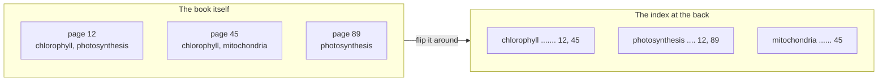
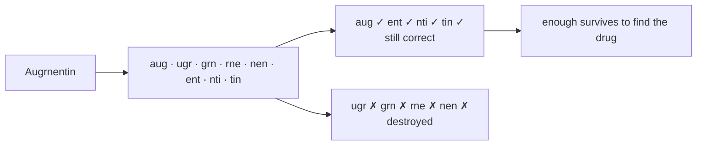
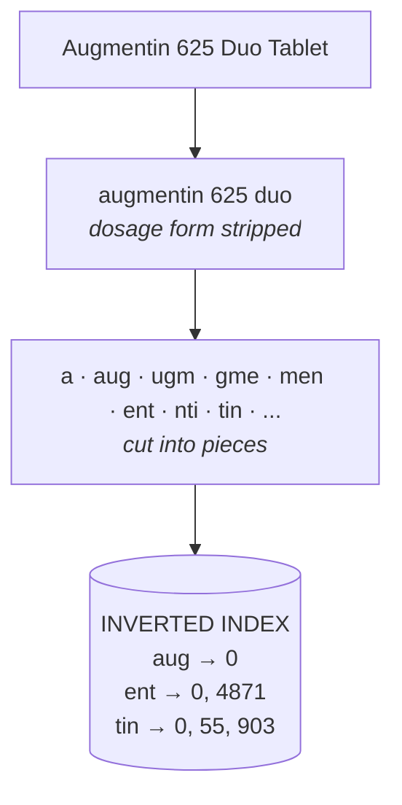
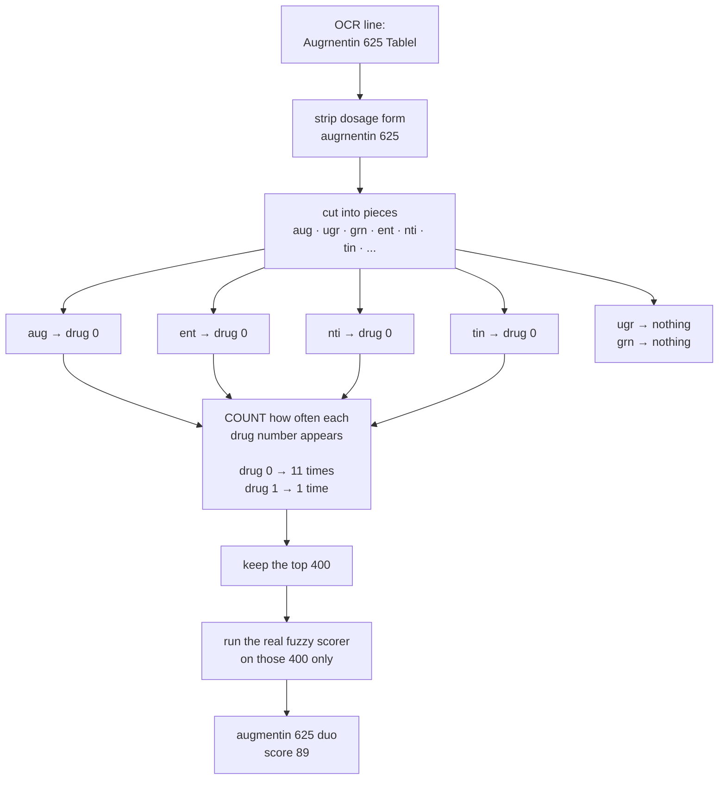
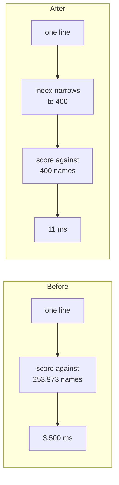

# How the medicine index works

Matching one line of OCR text against 254,000 drug names used to take about
3.5 seconds. It now takes about 11 milliseconds, with the same results. This is
how, in the smallest number of ideas possible.

## Start with a textbook

Open the back of any textbook and you find this:



The book goes **page to words on it**. The index goes **word to pages containing
it**. That flip is the entire idea, and "inverted index" is just its name.

To find photosynthesis you don't read 300 pages. You look up one word and it
hands you two page numbers.

## Ours is the same, with two swaps

| Textbook | Here |
|---|---|
| pages | drugs |
| whole words | three-letter pieces |

```
textbook:   "photosynthesis"  ->  12, 89      page numbers
ours:       "aug"             ->  0, 1        drug numbers
```

The numbers are positions in the drug list. Drug 0, drug 1. That's all they are.

## Why three-letter pieces and not whole words

Because OCR misreads. `Augmentin` comes back as `Augrnentin` — the `m` read as
`rn`.

A word index fails completely: `Augrnentin` simply isn't in it.

A piece index survives, because most of the pieces are still correct:



**Whole words break under OCR damage. Pieces don't.** If you remember one
sentence, remember that one.

## Building the index

Done once, at startup.



Walk every drug name, cut it up, and record its position under each piece. With
254,000 names that produces about 3.1 million entries.

## Looking something up

Done for every line of OCR text.



The step people trip over is the counting one, so to be explicit:

> **"drug 0 appeared 11 times" and "drug 0 shares 11 pieces with the query" are
> the same statement.**

The count *is* the similarity estimate. Nothing clever happens — you look up
pieces and tally which drug numbers keep coming back.

## Where the speed comes from



The scoring function is unchanged. The threshold is unchanged. The only
difference is how many candidates ever reach it.

That is why the answers don't change — verified against brute force on corrupted
drug names, identical results both ways.

## If you forget how it works

Three questions rebuild it from nothing:

1. **What am I looking up?** — a three-letter piece
2. **What does it give me?** — a list of drug numbers
3. **What do I do with them?** — count which number appears most

## What it costs

**Products merge.** Stripping the dosage form means `Azithral 500 Tablet` and
`Azithral 500 Injection` become the same key, `azithral 500`. About 8,500 groups
collapse this way. The original names are kept alongside so nothing is lost, but
the *match* can't tell them apart. Fine for reading a prescription where the form
often isn't legible; not fine for a dispensing system.

**It can miss.** The index is a filter, not an exhaustive search. If a name
shares very few pieces with the query it never reaches scoring, even if it would
have scored well. Measured at zero misses across 60 corrupted names — which means
the real rate is probably under 5%, not that it is zero. A provable bound exists
via minimum-overlap thresholds; this uses the measured route instead.

**Memory and build time.** About 3.1 million entries held in RAM, and 46 seconds
to build, cached to disk and reloaded in 0.2 s.
